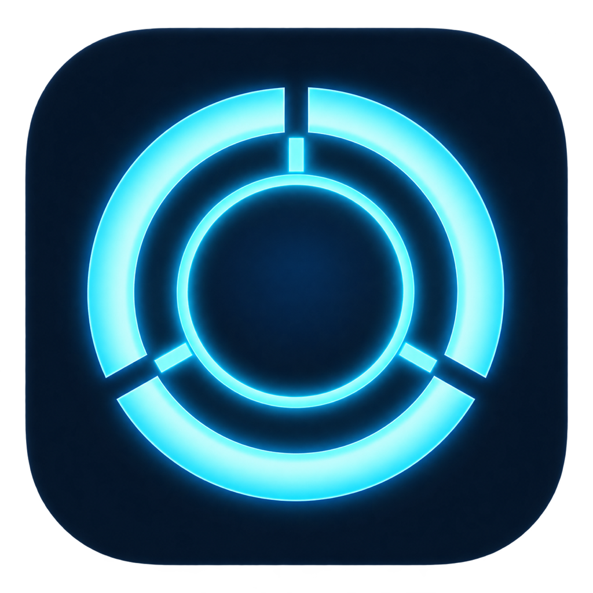

# jarvis

Created in [T3 Code](https://t3.codes).

Voice assistant for the Mac: say "Hey Jarvis" and talk to it through ElevenLabs' Eleven Realtime.

## Run

```sh
uv sync
uv run python -m jarvis
```

Jarvis lives in the menu bar as a HAL 9000 eye that doubles as a status light: grey when it isn't listening (starting or retrying after an error), dim red while waiting for "Hey Jarvis", bright red during a conversation. Its menu shows what it's doing ("Listening for “Hey Jarvis”", "In conversation", or an error it's retrying), **Talk now** to start a conversation without the wake word, **Microphone** to pick which mic Jarvis listens on (remembered in `~/.config/jarvis/mic`), and **Quit Jarvis**.

## What it can do

Ask in Portuguese or English:

- **Open apps and URLs**: "open Slack", "abre o GitHub"
- **Volume and music**: "volume 30", "mute", "pause the music", "next song" (media keys, so any player)
- **Timers**: "timer 10 minutes for the pasta"; Jarvis speaks and notifies when it ends (lost if Jarvis quits)
- **Reminders**: "remind me tomorrow at 5 to call Ana" goes to Apple Reminders, so it reaches your phone too
- **Clipboard**: "read what I copied"
- **Screen**: "what's on my screen?" takes a screenshot and has Codex describe it (about 10 s, uses your ChatGPT login)

First use of each asks for a macOS permission for the app running Jarvis: Accessibility (media keys), Automation for Reminders, Screen Recording (screen).

Needs `ELEVEN_LABS_API_KEY` in the environment or in `~/.claude/.env`. Each start pushes the agent config in `jarvis/agent.py` to ElevenLabs, creating the "Jarvis" agent on first run. A session ends when you say goodbye or after 12 s of silence.

## Test

```sh
uv run pytest
```
